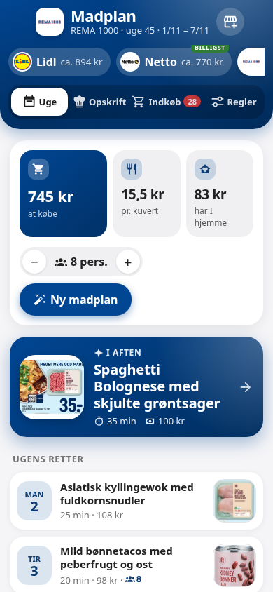
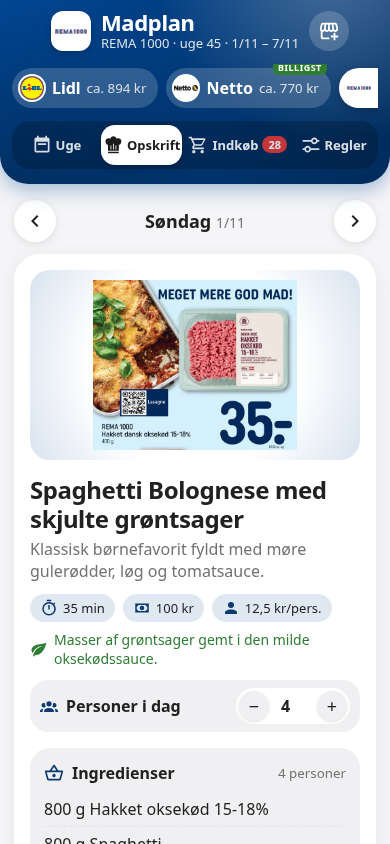
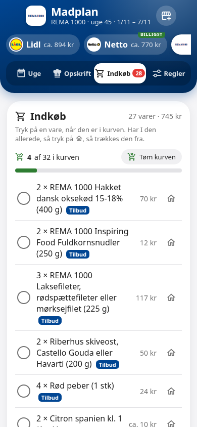
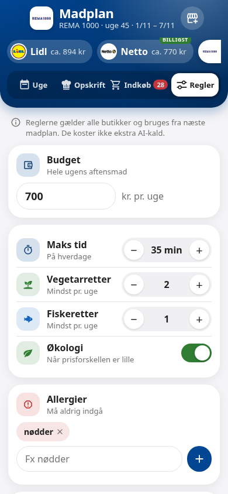

# Madplan til Home Assistant

Ugens aftensmad ud fra ugens tilbud – med opskrifter, indkøbsliste og priser. Madplan bruger den AI, du allerede har i Home Assistant, og virker med 14 danske kæder.

<p>
  
  
  
  
</p>

> **Uofficiel integration.** Den er ikke lavet af eller tilknyttet nogen af kæderne. Tilbud hentes fra eTilbudsavis, og normalpriser fra REMA 1000's åbne produkt-API.

## Det kan den

- **Ugens madplan** for 7 dage, bygget på tilbuddene i den butik, du vælger. Ny plan kommer automatisk lørdag kl. 10.
- **Flere butikker**: én plan pr. kæde, og du kan sammenligne dem. Den billigste bliver markeret.
- **Ærlige priser**: tilbudspriser er butikkens egne. Uden for REMA 1000 er prisen på varer, der ikke er på tilbud, et cirkatal (vist som "ca.").
- **Opskrifter** med ingredienser og fremgangsmåde i den mængde, I skal bruge.
- **Indkøbsliste**: tryk på en vare, når den er i kurven, eller på huset, hvis I har den hjemme. Kurven deles mellem jeres telefoner.
- **Ekstra varer**: skriv fx "pålæg", "rugbrød" eller "frugt til madpakker", så finder den tilbud. De huskes til næste uge.
- **Gæster**: sæt antallet af personer for én dag. Mængder og pris regnes om med det samme.
- **Familiens regler**: budget, økologi, allergier, ting I vil undgå, yndlingsretter, antal vegetar- og fiskeretter, maks tid på hverdage, faste dage (fx fredag: pizza) og andre krav. Planen bliver tjekket mod reglerne, og brud vises som advarsler.
- **Eget punkt i sidemenuen**, der virker som en app på telefonen. Tre designs og frit valg af farve.
- **Send indkøbslisten** til en to-do-liste i Home Assistant eller som mail.

### Kæder

REMA 1000, Netto, føtex, Bilka, Lidl, 365discount, Kvickly, SuperBrugsen, Brugsen, MENY, SPAR, Løvbjerg, Min Købmand og ABC Lavpris.

## Krav

- Home Assistant 2025.8 eller nyere.
- En **AI Task**-enhed, fx fra Google Generative AI (Gemini), OpenAI eller Anthropic. Se [AI Task](https://www.home-assistant.io/integrations/ai_task/).

### Kan det gøres gratis?

Ja, med Googles gratis Gemini-nøgle. Integrationen er bygget til at bruge så få AI-kald som muligt:

- AI'en får kun ugens tilbud. Andre varer slås op i REMA 1000's katalog af selve integrationen.
- En ny madplan med ekstra varer er **ét** kald. Byt ret og nye ekstra varer er ét kald hver.
- Mængder, priser, personer, gæster, regler og indkøbsliste koster ingen kald.

Gemini's gratis plan har et loft på antal kald om dagen. Almindelig brug ligger langt under det, men mange tests i træk kan ramme loftet. Så skriver Madplan, at kvoten er brugt op, og den virker igen næste dag.

## Installation

### Med HACS

1. Åbn HACS, tryk på de tre prikker og vælg **Brugerdefinerede repositories**.
2. Tilføj `https://github.com/Clahen86/ha-madplan` som type **Integration**.
3. Søg efter **Madplan**, installer, og genstart Home Assistant.

### Manuelt

Kopier mappen `custom_components/madplan` til `config/custom_components/` og genstart Home Assistant.

## Opsætning

1. Gå til **Indstillinger → Enheder og tjenester → Tilføj integration** og vælg **Madplan**.
2. Vælg butik og AI Task-enhed. Du kan også vælge en to-do-liste og en notify-tjeneste til mail.
3. Den første madplan bliver lavet med det samme. Åbn **Madplan** i sidemenuen.

Tilføj flere butikker ved at tilføje integrationen igen, eller tryk på butiksikonet øverst i Madplan.

### Kort til dine egne dashboards

Integrationen registrerer kortet selv – du skal ikke tilføje en ressource:

```yaml
type: custom:madplan-card
```

## Enheder

For hver butik:

| Enhed | Hvad |
| --- | --- |
| `sensor.madplan_<butik>` | Pris for ugens indkøb. Attributterne har retter, totaler, regler og advarsler. |
| `sensor.madplan_<butik>_<dag>` | Dagens ret. Attributterne har opskrift, pris, personer og billede. |
| `todo.madplan_<butik>_varer` | Indkøbslisten til aftensmaden. |
| `todo.madplan_<butik>_ekstra_varer` | Ekstra varer (pålæg, madpakker …). |
| `number.madplan_<butik>_personer` | Antal personer. |
| `button.madplan_<butik>_ny_plan` | Lav en ny plan. |
| `button.madplan_<butik>_send_indkobsliste` | Send indkøbslisten. |

## Handlinger

| Handling | Hvad |
| --- | --- |
| `madplan.ny_plan` | Ny plan (alle butikker, hvis `entity_id` udelades). |
| `madplan.byt_ret` / `madplan.fjern_ret` | Byt eller fjern én dags ret (`dag`: 1 = søndag … 7 = lørdag). |
| `madplan.dag_personer` | Antal personer én dag (0 = som resten af ugen). |
| `madplan.tilfoej_behov` / `madplan.fjern_behov` | Ekstra varer, fx `tekst: ["pålæg", "frugt"]`. |
| `madplan.ekstra_antal` | Antal pakninger af en ekstra vare. |
| `madplan.marker` / `madplan.toem_kurv` | I kurven eller har hjemme. |
| `madplan.gem_regler` | Familiens regler. |
| `madplan.overfoer` | Send indkøbslisten. |

Eksempel – 8 personer til aftensmad fredag:

```yaml
action: madplan.dag_personer
data:
  entity_id: sensor.madplan_rema_1000
  dag: 6
  personer: 8
```

## Godt at vide

- **Allergier**: AI'en får besked om aldrig at bruge dem, og planen bliver tjekket for dem. Men AI kan tage fejl – læs altid ingredienserne, hvis nogen har en alvorlig allergi.
- **Priser** er vejledende. Tilbud kan være udsolgt, og cirkapriser uden for REMA 1000 er anslået ud fra REMA's normalpriser.
- **Tilbud** skal gælde på den dag, I handler (planens første dag eller i dag). Indkøbslisten viser, hvornår det første tilbud udløber.
- Data om planer, regler og kurv bliver i din Home Assistant. AI'en får kun tilbud, regler og antal personer.

## Licens

MIT – se [LICENSE](LICENSE).
