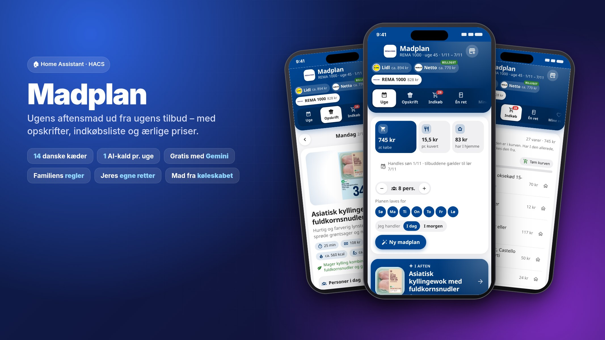
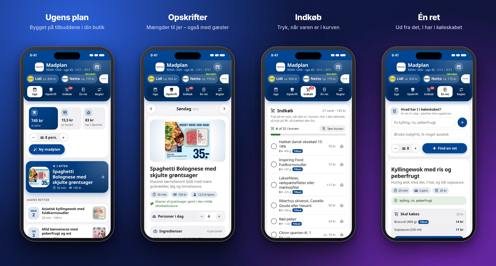
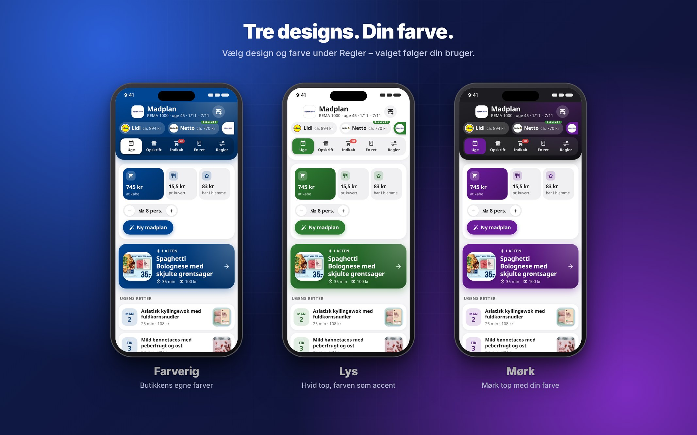
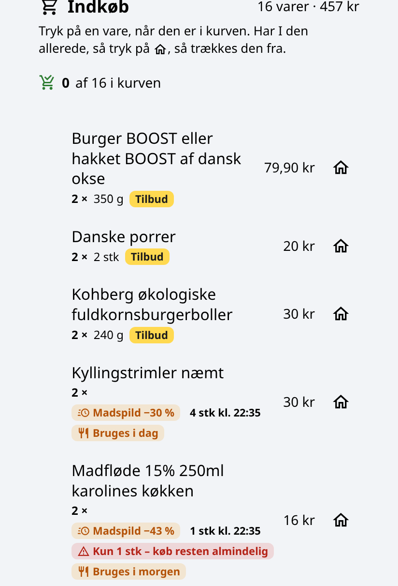

<p align="center"></p>

# Madplan til Home Assistant

[](https://github.com/Clahen86/ha-madplan/actions/workflows/validate.yml)

Ugens aftensmad ud fra ugens tilbud – med opskrifter, indkøbsliste og priser. Madplan bruger den AI, du allerede har i Home Assistant, og virker med 14 danske kæder.

<p align="center"></p>

> **Uofficiel integration.** Den er ikke lavet af eller tilknyttet nogen af kæderne. Tilbud hentes fra eTilbudsavis, normalpriser fra REMA 1000's åbne produkt-API og – hvis du vil – fra Salling Groups API med din egen nøgle.

## Det kan den

- **Ugens madplan**, bygget på tilbuddene i den butik, du vælger. Ny plan kommer automatisk lørdag kl. 10. Laves den midt på ugen, planlægges kun fra i dag til lørdag.
- **Flere butikker**: én plan pr. kæde, og du kan sammenligne dem. Den billigste bliver markeret.
- **Handl i to butikker** (valgfrit): ligger fx REMA og Netto tæt, kan planen også bruge tilbud fra op til 2 andre kæder (Regler → *Handler også i*). Er samme vare mindst 10 % billigere pr. kg i en anden butik, flyttes den dertil – men kun hvis der skal købes mindst 3 varer i butikken (kan ændres under Regler), så du ikke går derhen for én vare. Indkøbslisten deles op pr. butik.
- **Ærlige priser**: tilbudspriser er butikkens egne. Uden for REMA 1000 er prisen på varer, der ikke er på tilbud, et cirkatal (vist som "ca.") – medmindre du bruger en Salling-nøgle (se nedenfor).
- **Rigtige priser i Netto, føtex og Bilka** (valgfrit): med din egen gratis Salling Group-nøgle hentes priserne fra din egen butik.
- **Madspild** (valgfrit, samme nøgle): ekstra nedsatte varer med kort dato bruges i planens første 2 dage. Indkøbslisten viser, om de stadig er der.
- **Opskrifter** med ingredienser og fremgangsmåde i den mængde, I skal bruge. Hver dag kan sendes på mail med sin egen indkøbsliste.
- **Indkøbsliste**: tryk på en vare, når den er i kurven, eller på huset, hvis I har den hjemme. Kurven deles mellem jeres telefoner.
- **Ekstra varer**: skriv fx "pålæg", "rugbrød" eller "frugt til madpakker", så finder den tilbud. De huskes til næste uge.
- **Gæster**: sæt antallet af personer for én dag. Mængder og pris regnes om med det samme.
- **Vælg dage**: slå dage fra (fx når I spiser ude onsdag), så planen kun laves for resten.
- **Opskrifter der hænger sammen**: nævner trinene noget, der ikke står på ingredienslisten (fx løg eller bare "krydderier"), retter AI'en opskriften i ét ekstra kald.
- **Rester**: lav en ret til 2 dage – mængden fordobles, og næste dag bliver rester uden indkøb.
- **Én ret fra køleskabet**: skriv hvad I har, og få én ret til i dag med en liste over det, der mangler – helt adskilt fra ugeplanen. Send kun det, der mangler, på mail eller indkøbslisten.
- **Familiens regler**: niveau (hverdag, hygge eller gourmet), husstand (børn eller voksne), budget, økologi, allergier, ting I vil undgå, yndlingskøkkener, antal vegetar- og fiskeretter, maks tid på hverdage og i weekenden, faste dage (fx fredag: pizza) og andre krav. Planen bliver tjekket mod reglerne (også allergener i sammensatte ord som "rødløg" og samme protein for mange gange), og brud vises som advarsler.
- **Mine retter**: jeres egne opskrifter med ingredienser, fremgangsmåde, antal portioner, link og noter til AI'en. Hver opskrift kan slås til og fra, og under *Hvor tit* vælger I aldrig, nogle gange eller ofte. AI'en tager de tilslåede med, når tilbuddene passer, bruger jeres ingredienser (regnet om til jeres antal personer) og viser jeres egen fremgangsmåde. En opskrift kan "række til 2 dage", så næste dag automatisk bliver rester. Tryk *Gem som min ret* under en opskrift i planen for at gemme den og rette den til.
- **Mål pr. portion** (valgfrit): sæt kcal og/eller protein pr. portion under Regler. Hver ret viser AI'ens skøn ("ca. 640 kcal · ca. 34 g protein"), og der kommer en advarsel, hvis retter ligger langt fra målet. Tallene er et skøn – ikke præcise næringsberegninger.
- **Automatisk plan pr. butik**: vælg under Regler, hvilke butikker der laver plan hver lørdag. De andre laver kun plan, når du trykker (sparer AI-kald).
- **Eget punkt i sidemenuen**, der virker som en app – også på en lille telefonskærm. Fanerne i toppen kan rulles sidelæns på telefonen. Tre designs og frit valg af farve.
- **Send indkøbslisten** til en to-do-liste i Home Assistant eller som mail – også til flere modtagere (fx begge telefoner).

<p align="center"></p>

### Kæder

REMA 1000, Netto, føtex, Bilka, Lidl, 365discount, Kvickly, SuperBrugsen, Brugsen, MENY, SPAR, Løvbjerg, Min Købmand og ABC Lavpris.

## Krav

- Home Assistant 2025.8 eller nyere.
- En **AI Task**-enhed, fx fra Google Generative AI (Gemini), OpenAI eller Anthropic. 👉 **[Guide: sæt gratis AI op med Gemini](docs/guide-ai.md)**

### Kan det gøres gratis?

Ja, med Googles gratis Gemini-nøgle. Integrationen er bygget til at bruge så få AI-kald som muligt:

- AI'en får kun ugens tilbud. Andre varer slås op i REMA 1000's katalog af selve integrationen.
- En ny madplan med ekstra varer er **ét** kald. Byt ret, nye ekstra varer og Én ret er ét kald hver.
- Mængder, priser, personer, gæster, regler og indkøbsliste koster ingen kald.

Gemini's gratis plan har et loft på antal kald om dagen. Almindelig brug ligger langt under det, men mange tests i træk kan ramme loftet. Så skriver Madplan, at kvoten er brugt op, og den virker igen næste dag.

## Installation

### Med HACS

1. Åbn HACS og søg efter **Madplan**.
2. Installer, og genstart Home Assistant.

Kan du ikke finde den i søgningen, kan du tilføje den som brugerdefineret repository:

1. Åbn HACS, tryk på de tre prikker og vælg **Brugerdefinerede repositories**.
2. Tilføj `https://github.com/Clahen86/ha-madplan` som type **Integration**.
3. Søg efter **Madplan**, installer, og genstart Home Assistant.

### Manuelt

Kopier mappen `custom_components/madplan` til `config/custom_components/` og genstart Home Assistant.

## Opsætning

1. Gå til **Indstillinger → Enheder og tjenester → Tilføj integration** og vælg **Madplan**.
2. Vælg butik og AI Task-enhed. Du kan også vælge en to-do-liste og en notify-tjeneste til mail – 👉 **[Guide: få listen på mail](docs/guide-mail.md)**.
3. Den første madplan bliver lavet med det samme. Åbn **Madplan** i sidemenuen.

Tilføj flere butikker ved at tilføje integrationen igen, eller tryk på butiksikonet øverst i Madplan.

### Rigtige priser i Netto, føtex og Bilka (valgfrit)

Uden nøgle virker alt som normalt med ca.-priser. Med en gratis nøgle fra Salling Group får Netto, føtex og Bilka rigtige priser fra den butik, du vælger.

**Én nøgle til alle:** sæt nøglen ind i én af kæderne, så bruger Netto, føtex og Bilka den. Tilføjer du en ny af dem, vælger du kun din lokale butik.

👉 **[Guide: hent en Salling-nøgle trin for trin](docs/guide-salling.md)** – også med *Food Waste API* til madspild.

<p align="center"></p>

**Madspild:** slå *Madspild* til under **Regler**. Planen bruger så 1-2 ekstra nedsatte varer fra din Salling-butik i de første 2 dage (kød og fisk kan fryses og bruges senere). Varerne kan blive udsolgt, så:

- Retten virker altid med den almindelige vare – madspild-varen er en bonus.
- Er der færre på lager, end retten skal bruge, står der fx *Kun 1 stk – køb resten almindelig*.
- Indkøbslisten viser fx *−50 % · Nedsat i dag · 3 stk kl. 14:30* og *Bruges i dag* (eller *Frys samme dag*, hvis kød/fisk først bruges senere).
- Den tjekker hver halve time (kl. 7-21:30). Bliver en vare udsolgt, byttes den automatisk til den almindelige vare med rigtig pris, og linjen får mærket *Madspild udsolgt – almindelig pris*.
- **Nye madspild-varer** i butikken, der passer til ugens retter (fx hakket oksekød til tacos), sættes ind i stedet for den almindelige vare, når de er billigere – også efter allergier og *Undgå*.
- **Handler du i en anden butik i dag?** Tryk *Handler et andet sted?* på indkøbslisten og vælg butikken. Madspild tjekkes så dér, og varer, den ikke har, byttes til den almindelige vare og pris. Skifter du tilbage, eller kommer en vare på lager igen, kommer madspild-varen tilbage af sig selv.
- Madspild bruges kun, når der handles i dag eller i morgen. Det koster ingen ekstra AI-kald.

### Indkøbslisten i REMA 1000-appen (valgfrit)

Under **Konfigurer** på din REMA 1000-madplan kan du skrive din REMA-kontos e-mail og kodeord. Så får indkøbslisten sin egen knap, **Send til REMA-appen** (adskilt fra *Send indkøbsliste*, der sender mail/besked), som lægger ugens varer på din indkøbsliste i REMA 1000-appen – også ugens tilbud som præcis den vare (REMA's varenummer findes i kataloget). Sender du igen, bliver antallet ikke dobbelt.

> Uofficielt: REMA 1000 har ingen offentlig API til indkøbslister, så Madplan bruger de samme kald som rema1000.dk (samme fremgangsmåde som [ha-rema1000](https://github.com/madskelkjaer/ha-rema1000)). Det kan holde op med at virke, hvis REMA ændrer deres side – så fejler kun afsendelsen til appen. Kodeordet gemmes i Home Assistant og sendes kun til REMA 1000.

### Kort til dine egne dashboards

Integrationen registrerer kortet selv – du skal ikke tilføje en ressource:

```yaml
type: custom:madplan-card
```

## Enheder

For hver butik:

| Enhed | Hvad |
| --- | --- |
| `sensor.madplan_<butik>` | Pris for ugens indkøb. Attributterne har retter, totaler, regler og advarsler. |
| `sensor.madplan_<butik>_<dag>` | Dagens ret. Attributterne har opskrift, pris, personer og billede. |
| `todo.madplan_<butik>_varer` | Indkøbslisten til aftensmaden. |
| `todo.madplan_<butik>_ekstra_varer` | Ekstra varer (pålæg, madpakker …). |
| `number.madplan_<butik>_personer` | Antal personer. |
| `button.madplan_<butik>_ny_plan` | Lav en ny plan. |
| `button.madplan_<butik>_send_indkobsliste` | Send indkøbslisten. |

## Handlinger

| Handling | Hvad |
| --- | --- |
| `madplan.ny_plan` | Ny plan (alle butikker, hvis `entity_id` udelades). |
| `madplan.byt_ret` / `madplan.fjern_ret` | Byt eller fjern én dags ret (`dag`: 1 = søndag … 7 = lørdag). |
| `madplan.dag_personer` | Antal personer én dag (0 = som resten af ugen). |
| `madplan.rester` | Lav én dags ret til 2 dage (`til: false` fortryder). |
| `madplan.auto_plan` | Automatisk lørdagsplan til/fra for en butik (`til: false`). |
| `madplan.ekstra_butikker` | Andre kæder, planen også må bruge tilbud fra, fx `butikker: ["netto"]`. |
| `madplan.tilfoej_behov` / `madplan.fjern_behov` | Ekstra varer, fx `tekst: ["pålæg", "frugt"]`. |
| `madplan.ekstra_antal` | Antal pakninger af en ekstra vare. |
| `madplan.marker` / `madplan.toem_kurv` | I kurven eller har hjemme. |
| `madplan.en_ret` | Én ret fra køleskabet, fx `har: ["kylling", "ris"]`. |
| `madplan.en_ret_mail` / `madplan.en_ret_paa_listen` | Send det, der mangler til én ret, på mail eller indkøbslisten. |
| `madplan.dag_mail` | Send én dags ret fra ugeplanen på mail med indkøbsliste og opskrift. |
| `madplan.gem_regler` | Familiens regler. |
| `madplan.gem_min_ret` | Gem eller ret en egen opskrift (navn, ingredienser, fremgangsmåde, til/fra …). Giver id tilbage. |
| `madplan.slet_min_ret` | Slet en egen opskrift. |
| `madplan.hent_min_ret` | Hent hele opskriften (svar). |
| `madplan.overfoer` | Send indkøbslisten. |

Eksempel – 8 personer til aftensmad fredag:

```yaml
action: madplan.dag_personer
data:
  entity_id: sensor.madplan_rema_1000
  dag: 6
  personer: 8
```

## Godt at vide

- **Allergier**: AI'en får besked om aldrig at bruge dem, og planen bliver tjekket for dem. Men AI kan tage fejl – læs altid ingredienserne, hvis nogen har en alvorlig allergi.
- **Priser** er vejledende. Tilbud og madspild-varer kan være udsolgt, og cirkapriser uden for REMA 1000 er anslået ud fra REMA's normalpriser (eller hentet fra Salling Group, hvis du bruger en nøgle).
- **Tilbud** skal gælde på den dag, I handler (planens første dag eller i dag). Kæderne skifter avis på forskellige dage, så du behøver ikke vente – planen bruger de tilbud, der gælder, når du handler. Vælg **Jeg handler: I dag / I morgen** ved "Ny madplan". Den automatiske lørdagsplan venter til søndag kl. 7, hvis næste uges avis ikke er ude endnu. Indkøbslisten viser, hvornår det første tilbud udløber.
- Data om planer, regler og kurv bliver i din Home Assistant. AI'en får kun tilbud, regler og antal personer.

## Licens

MIT – se [LICENSE](LICENSE).
